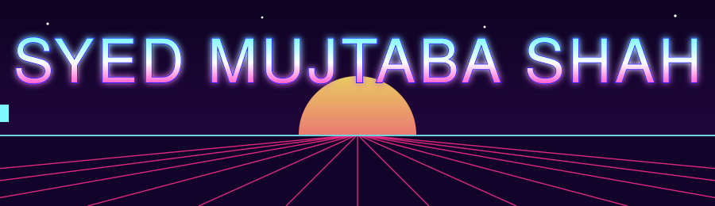

  

 

**i love code** **and models that cite their sources**

 

check out my final-year project: [Sakinah](https://github.com/syedmujtaba-s/sakinah-fyp)

and [FaithBrains](https://github.com/syedmujtaba-s/faith-brains), search with cited answers

 

[LinkedIn](https://www.linkedin.com/in/syedmujtaba-s) · mujtabashah.dev@gmail.com

